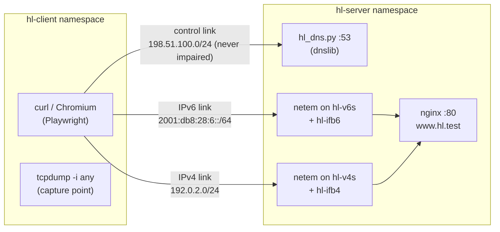

# HappyLab: measuring Happy Eyeballs IPv4/IPv6 fallback

HappyLab is an isolated Linux network lab that measures how two real clients, **curl** and
**Chromium**, recover when one address family is broken or slow. We break the IPv6 path, the IPv4
path or the DNS answer under seven controlled conditions and run each client 20 times per condition,
280 runs in all. Each run is captured with tcpdump, and the result is computed from the packets on
the wire, not from the client's own report. Built by team NetDefenders for AIORI-3 problem statement
PS-028.

**[Website](https://happylab-aiori-ps-028.vercel.app)** ·
**[Demo video](https://youtu.be/DnplR7TfhMs)** ·
**[Technical report](docs/report.md)** ·
**[Project proposal (PDF)](A3-PS028-HappyLab-Project-Proposal.pdf)** ·
[Team intro](https://youtu.be/TA8UYlIY-GY) ·
[Licence: MIT](LICENSE)

## What this measures and why

A host with both IPv4 and IPv6 can reach most servers either way. If it always tried IPv6 first and
the IPv6 path were silently broken, the user would wait for a full TCP connect timeout before
anything happened. **Happy Eyeballs** avoids that: the client starts with the preferred family and,
if that hasn't connected after a short delay, starts a parallel attempt over the other family.
The first handshake to complete wins.

[RFC 8305](https://www.rfc-editor.org/rfc/rfc8305) describes the design. We use it as a reference,
not as a predictor of exact timings. It recommends 250 ms as the Connection Attempt Delay. That is
one recommended value, not a threshold a client must meet, and curl's documented default is 200 ms.

HappyLab asks a practical question: under each condition, which family wins, how long does the TCP
connection take, and when does the client start the other family? The answers are measured, not
inferred from client documentation.

## Headline findings

Medians over 20 runs per client and condition, from `src/analysis/summarise.py` over the 14
sessions listed in [`docs/dataset.md`](docs/dataset.md). Timings are packet-level, from the
capture. "Setup" is TCP setup time, from the first SYN to the ACK that completes the winning
handshake (DNS time excluded).

| Condition | curl | Chromium |
|---|---|---|
| C0 healthy baseline | IPv6 wins 20/20, setup 20.697 ms | IPv6 wins 20/20, setup 20.135 ms |
| S1 IPv6 blackhole | IPv4 wins 20/20, IPv4 started 200.956 ms after the first IPv6 SYN, setup 222.221 ms | IPv4 wins 20/20, IPv4 started 301.067 ms after the first IPv6 SYN, setup 322.392 ms |
| S2 IPv6 +600 ms RTT | IPv4 wins 20/20, IPv4 at 200.956 ms, setup 222.188 ms | IPv4 wins 20/20, IPv4 at 301.12 ms, setup 321.986 ms |
| S3 IPv6 +150 ms RTT | IPv6 wins 20/20, setup 171.171 ms, IPv4 never tried | IPv6 wins 20/20, setup 171.109 ms, IPv4 never tried |
| S4 IPv4 blackhole | IPv6 wins 20/20, setup 20.715 ms, no IPv4 SYN in any run | IPv6 wins 20/20, setup 20.139 ms, no IPv4 SYN in any run |
| S5 IPv4 +600 ms RTT | IPv6 wins 20/20, setup 20.697 ms, no IPv4 SYN in any run | IPv6 wins 20/20, setup 20.139 ms, no IPv4 SYN in any run |
| S6 AAAA answer delayed 300 ms | DNS time 302.07 ms, setup 20.812 ms | DNS time 301.851 ms, setup 21.317 ms |

- **curl falls back to IPv4 about 200 ms after its first IPv6 SYN** in S1 and S2, with one
  abandoned IPv6 attempt per run.
- **Chromium falls back about 100 ms later than curl.** In every S1 and S2 run it sends a second
  IPv6 SYN from a new socket, a median 250.625 ms (S1) after the first, before starting IPv4 at
  about 301 ms. Pcap and NetLog evidence traced that second SYN to Chromium's own backup attempt to
  the same IPv6 address, not to a TCP retransmission. This is an observation in this set-up (one
  Chromium version, headless, under Playwright), not a statement about Chromium's documented
  behaviour. See [`docs/findings/chromium_s1_second_v6_syn.md`](docs/findings/chromium_s1_second_v6_syn.md).
- **A slower but working IPv6 path still wins.** At +150 ms (S3), IPv6 connected in about 171 ms
  and neither client tried IPv4.
- **IPv4 faults went unnoticed (S4, S5).** Both clients preferred IPv6 and never sent an IPv4
  SYN. This result is scoped to this lab's resolver configuration, where curl uses glibc's default
  address selection in the namespace and Chromium's own resolver also ordered IPv6 first. It is not
  a universal result.
- **Both clients waited for the slow AAAA answer (S6).** In 20/20 runs per client the first SYN was
  sent only after the AAAA answer (at about 302 ms), although the A answer arrived in about 1 ms. The
  delay shows in DNS time, not in TCP setup time, so S6 is always reported with both.
- **Every run succeeded with HTTP 200 (280/280), and every log-versus-capture cross-check agreed.**

The technical report has the full tables (interquartile ranges, scenario penalties, abandoned
attempts) and the reasoning behind each statement: [`docs/report.md`](docs/report.md).

## Lab architecture

Everything runs on one Ubuntu machine in two Linux network namespaces. The host's own network
configuration is never touched.



- **Namespace isolation.** `hl-client` and `hl-server` are joined by three veth links: IPv6, IPv4
  and a control link that carries only DNS. All addresses are documentation prefixes and never
  leave the namespaces. Names and addresses live in [`src/lab/lab.env`](src/lab/lab.env).
- **Server-side netem plus an ifb redirect.** Impairments are applied only on the server side:
  netem on the server end of each link (server to client), and netem on an ifb device that receives
  the server end's redirected ingress (client to server). The client interfaces carry no qdisc, so
  tcpdump in `hl-client` sees every packet at the moment the client sends it. Dropped SYNs still
  appear in the capture, with true timestamps.
- **Static neighbour entries for blackholes.** A blackhole is 100% netem loss. Permanent ARP/ND
  neighbour entries keep it a silent drop, so the client sees no "host unreachable" error.
- **Controlled DNS.** [`src/dns/hl_dns.py`](src/dns/hl_dns.py) is a small authoritative server
  (Python, dnslib) for `www.hl.test`, with TTL 0 and an optional per-record-type delay (S6 holds the
  AAAA answer for 300 ms). `hl-client` gets its own `resolv.conf` and `gai.conf` from
  `/etc/netns/hl-client/`.
- **nginx inside the server namespace.** The orchestrator starts nginx in `hl-server` as the normal
  user, with [`src/config/nginx.conf`](src/config/nginx.conf) (HTTP/1.1, keep-alive off). The host's
  nginx service is not used.
- **Measured, not assumed.** Before every run, `verify.sh` measures the real RTT with ping. A run goes
  ahead only if the median is within max(2 ms, 10%) of target, or, for a blackhole, if there is 100%
  loss with no ICMP errors. The measured value is stored in the run record.

## Scenarios

The baseline is 10 ms each way on both data links, a 20 ms RTT. "+N ms RTT" is added to that 20 ms
baseline and split across the two directions. For example, "+600 ms" means a 620 ms target, or
310 ms each way. The latency scenarios are **mobile-inspired latency conditions**, not carrier
measurements. The netem values were validated by pilot runs and are specific to this lab.

| ID | Condition | What it does | Verify target (v4 / v6) |
|---|---|---|---|
| C0 | Healthy baseline | No impairment | 20 / 20 ms |
| S1 | IPv6 blackhole | 100% loss on the IPv6 link | 20 ms / blackhole |
| S2 | IPv6 +600 ms RTT | 310 ms each way on IPv6 | 20 / 620 ms |
| S3 | IPv6 +150 ms RTT | 85 ms each way on IPv6 | 20 / 170 ms |
| S4 | IPv4 blackhole | 100% loss on the IPv4 link | blackhole / 20 ms |
| S5 | IPv4 +600 ms RTT | 310 ms each way on IPv4 | 620 / 20 ms |
| S6 | AAAA delayed | The DNS server holds the AAAA answer for 300 ms; A is immediate | 20 / 20 ms |
| X1 | Compound stress (optional) | **Not run.** It was optional, was never defined, and the orchestrator does not accept it. | — |

Definitions are in [`src/config/scenarios.yaml`](src/config/scenarios.yaml). The RTTs measured
before the dataset's runs were 20.35–21.4 ms on baseline links, 171.0 ms for S3 and 621.0 ms for
S2/S5. Both blackholes were confirmed at 100% loss.

## Clients and versions

Read from the run records of the dataset (code version `ecba28c`, 2026-10-26):

| Client | Version | Configuration |
|---|---|---|
| curl | curl 8.5.0 (libcurl 8.5.0, OpenSSL 3.0.13) | `curl -q -sS --noproxy '*' --max-time 10 -o /dev/null -w … http://www.hl.test/`; Happy Eyeballs timeout left at its default; resolves through glibc |
| Chromium | Chromium 156.0.8078.4 via Playwright 1.64.1 | New headless mode, fresh browser and profile per run, Playwright's default of no sandbox. QUIC, DNS-over-HTTPS and HTTPS-Upgrades are disabled, and a NetLog is written per run. Loads `http://www.hl.test/chromium.html`. |

Lab host: Ubuntu 24.04, kernel 7.0.0-38-generic, Python 3.12.3, nginx 1.24.0, tcpdump 4.99.4.

## Method and evidence labels

Every statement in the results is one of three kinds, and is labelled as such in the summary,
the dashboard and the report:

- **Packet-level evidence**: from the packet capture taken inside `hl-client`. All timings, winning
  family, attempts and DNS times come from here.
- **Outcomes (client/runner logs)**: what a client reported about itself, such as curl's `-w` output,
  Chromium's NetLog and exit codes.
- **Interpretation**: our reading of the two above. It is never a measurement.

Fixed metric definitions:
- **TCP setup time:** first SYN to the ACK completing the winning handshake. DNS time is separate.
- **Inter-family attempt delay:** the second family's first SYN minus the first family's first SYN. It is "not observed" when only one family was tried.
- **Scenario penalty:** the client's median setup time minus its own C0 median.

Every record also stores the winning family, success or failure, and failed or abandoned attempts.

## Run record schema (v0.2)

One JSON file per run. Every derived field is a `{value, status}` pair, never a bare number. The status is
`computed`, `not_observed` or `not_applicable` (plus `not_yet_computed` before parsing). A
`cross_checks` block compares six things between the client's report and the capture:
- winning family
- success
- HTTP status
- connected address
- unexpected traffic (port 443, QUIC, other ports)
- capture completeness

Any disagreement is stored as a conflict with both values. The dataset has none.

```json
"tcp_setup_time_ms": { "value": 222.254, "status": "computed" },
"inter_family_attempt_delay_ms": { "value": 200.976, "status": "computed" },
"cross_checks": { "status": "agree", "conflicts": [] }
```

Full schema: [`docs/run_record_schema.md`](docs/run_record_schema.md). Two real records with
their captures and SHA-256 sums are in [`examples/`](examples/).

## Reproducing the measurements

> The lab needs root, because it creates namespaces and qdiscs and captures packets. Every command
> that needs it says `sudo`. Read the lab scripts before running them; they touch only the `hl-`
> namespaces and `/etc/netns/hl-client/`.

### Requirements

- Ubuntu 24.04 (the version the dataset was measured on), with root via `sudo`.
- Kernel modules `sch_netem`, `ifb`, `act_mirred` and `cls_matchall`. They are part of the standard
  `linux-modules` package, and `setup.sh` loads `sch_netem` and `ifb` itself.
- System packages: `iproute2` (ip, tc, ss), `iputils-ping`, `tcpdump`, `nginx`, `curl`, `kmod`,
  `python3.12-venv`.
- Python 3.12 and the pinned packages in [`requirements.txt`](requirements.txt), including
  Playwright 1.64.1 and its Chromium build.

### Set up

```bash
sudo apt install iproute2 iputils-ping tcpdump nginx curl kmod python3.12-venv
sudo systemctl disable --now nginx        # nginx runs only inside hl-server; keep the host service off

python3 -m venv .venv
.venv/bin/pip install -r requirements.txt
.venv/bin/python -m playwright install chromium   # Chromium 156.0.8078.4 for Playwright 1.64.1

scripts/test.sh                           # 285 tests; no root needed

sudo src/lab/setup.sh                     # build the lab, then verify it (prints PASS/FAIL per check)
sudo src/lab/verify.sh up                 # re-check at any time: real RTT on target
```

### Run one scenario

```bash
.venv/bin/python src/runner/orchestrate.py --scenario S1 --reps 1 --dry-run     # print every command, run nothing
sudo .venv/bin/python src/runner/orchestrate.py --scenario S1 --reps 1           # curl
sudo .venv/bin/python src/runner/orchestrate.py --client chromium --scenario S1 --reps 1
```

Each run writes `captures/<run_id>.pcap`, `data/generated/runs/<run_id>.json` and a log under
`data/generated/logs/`. The run ID has the form `<UTC time>_<scenario>_<client>_r<NN>`. The
orchestrator prints a one-line summary per run and the session log path.

### Run the full matrix

```bash
.venv/bin/python src/runner/run_matrix.py --dry-run     # the 14 batches, in order
sudo .venv/bin/python src/runner/run_matrix.py          # 7 scenarios × 2 clients × 20 repetitions
sudo .venv/bin/python src/runner/run_matrix.py --from 5           # resume at batch 5
sudo .venv/bin/python src/runner/run_matrix.py --only S3:chromium # one batch
```

- **Batch checks:** after every batch, `run_matrix.py` runs the read-only batch check. It stops on a failed
  verify, an incomplete capture, a cross-check conflict or a failed check, and never retries on its own.
  Output goes to `data/generated/lab/<UTC>_matrix/`.
- **Runtime:** the dataset's full matrix took 64.6 minutes on our machine. That is one observed run, not a guarantee.
- **Re-checking a batch:** to re-run the check for one batch, use its session ID from `matrix.log`:

```bash
.venv/bin/python src/analysis/check_batch.py --client curl --scenario S1 --expect 20 --session <session_id>
```

### Summarise, dashboard and website data

`summarise.py`, `dashboard.py` and `export_web.py` read **only** the 14 sessions listed in the
"Sessions in the dataset" table of [`docs/dataset.md`](docs/dataset.md). For a new matrix, put your
session IDs in that table first. Each script refuses an incomplete or unclean session.

```bash
.venv/bin/python src/analysis/summarise.py          # tables + labelled interpretation; writes data/generated/summary/summary.json
.venv/bin/python src/analysis/dashboard.py          # data/generated/summary/dashboard.html (Plotly, works offline)
.venv/bin/python src/analysis/export_web.py --check # would web/index.html change?
.venv/bin/python src/analysis/export_web.py         # rewrite only the generated-data block in web/index.html
```

### Tear down

```bash
sudo src/lab/teardown.sh                  # removes both namespaces and the lab files, then verifies nothing is left
```

### Known gotchas

- **`PYTHONPATH` and `LD_LIBRARY_PATH`.** Shells that set these, such as a ROS shell, must not
  pass them to the lab. Use plain `sudo`, never `sudo -E`: the orchestrator refuses to run if either
  variable is set. It also starts every client, server and tcpdump with both variables removed, and
  records that in the run record.
- **pytest plugins.** Run the tests with `scripts/test.sh`. It unsets `PYTHONPATH` and sets
  `PYTEST_DISABLE_PLUGIN_AUTOLOAD=1`, so plugins from other environments are not loaded.
- **File ownership.** The orchestrator runs as root but starts the clients, nginx and the DNS server
  as the user who called `sudo`. It chowns every file it creates (captures, records, logs) back to
  that user, and `run_matrix.py` does the same for its output folder. It refuses to start without
  `SUDO_USER`.
- **Re-measure netem every run.** The configured delays are not ground truth. Each run re-measures
  the RTT before it starts and stores the measurement. Use the measured value, not the configured
  one.
- **Host `gai.conf`.** The lab machine's own `/etc/gai.conf` prefers IPv4, and the lab never edits it.
  Processes in `hl-client` see the lab's comment-only file instead, so glibc's built-in default
  policy applies.
- **Reading captures on the host.** The captures use `tcpdump -i any`, which stores interface numbers,
  not names. The record's `environment.capture_interfaces` maps them.

## Repository layout

```
├── README.md                 this file
├── LICENSE                   MIT
├── A3-PS028-HappyLab-Project-Proposal.pdf
├── Proposed-structure-hackathon.pdf   the organisers' presentation template (not our project)
├── CLAUDE.md                 project rules: metric definitions, wording, lab safety
├── docs/
│   ├── report.md             technical report (methodology, results, limitations)
│   ├── dataset.md            the 14 sessions / 280 runs that make up the dataset
│   ├── run_record_schema.md  run record schema v0.2
│   ├── findings/             Chromium's second IPv6 SYN: pcap + NetLog analysis
│   └── examples/             hand-written schema example (used by the validator tests)
├── examples/                 two real runs (C0, S1 curl): record + pcap + SHA256SUMS
├── requirements.txt          pinned Python dependencies
├── pyproject.toml
├── scripts/test.sh           test runner (clean environment)
├── src/
│   ├── lab/                  setup.sh, teardown.sh, verify.sh, netem.sh, lib.sh, lab.env
│   ├── config/               scenarios.yaml, nginx.conf
│   ├── dns/                  hl_dns.py: test-zone DNS server with per-type delay
│   ├── runner/               orchestrate.py, run_matrix.py, client runners, child_env.py
│   ├── analysis/             parse_pcap.py, metrics.py, summarise.py, dashboard.py, export_web.py, check_batch.py, validators
│   └── tests/                285 pytest tests and two small fixture pcaps
└── web/index.html            the website: one static file, data generated by export_web.py
```

`captures/` and `data/generated/` hold the full dataset on the lab machine and are not in Git.

## Limitations and scope

- **One lab, one version of each client.** curl 8.5.0 and Chromium 156.0.8078.4 (headless, under
  Playwright) were measured on one Ubuntu host. Other versions, platforms or browser modes may behave
  differently.
- **Lab-specific address preference.** The IPv6-first behaviour in S4/S5 comes from this lab's
  resolver set-up: glibc defaults inside the namespace for curl, and Chromium's own resolver for
  Chromium. An IPv4-first policy was not tested.
- **Simplified conditions.** These are mobile-inspired latency conditions, not carrier measurements:
  fixed symmetric delay, no jitter, loss of either 0% or 100%, one family impaired at a time, and
  plain HTTP (no TLS, QUIC disabled).
- **Lab-specific netem values.** They were pilot-validated for this lab. The measured RTT is what we
  report.
- **Observed, not documented.** Chromium's ~250 ms and ~301 ms points are observed delays in this
  set-up. We make no claim about Chromium's internal timers, and no claim of conformance to
  RFC 8305 or the Happy Eyeballs v3 draft.
- **Sample size.** 20 runs per cell. We report medians and interquartile ranges, with no
  significance tests.
- **X1 not run.** The optional compound-stress scenario was not defined or measured.

The full list is in section 3 of the [technical report](docs/report.md).

## Website and demo video

- **Website:** <https://happylab-aiori-ps-028.vercel.app>. It is a single static page
  ([`web/index.html`](web/index.html)) that explains the method and shows the measured results. The
  Results and Evidence pages draw on the dataset, which `export_web.py` bakes into the page.
- **Playground:** an interactive model that runs in your browser. You can cut a cable, add latency
  or delay the AAAA answer, and it animates the race using model settings, not lab data. It does
  NOT run live measurements and makes no network calls. The measured results are on the Results and
  Evidence pages.
- **Network requests:** the page as a whole loads only its fonts from Google Fonts.
- **Demo video:** <https://youtu.be/DnplR7TfhMs>
- **Team intro video:** <https://youtu.be/TA8UYlIY-GY>

## Team and mentor

Team **NetDefenders**, AIORI-3 problem statement **PS-028** (team code A3-PS028-TC278).

- **Sam Rajeev**: backend and measurement
- **Pranav Murali**: frontend and testing
- **Mentor:** Dr. Monika Puttaramaiah

## Credits and prior work

- **Reference design:** D. Schinazi and T. Pauly, "Happy Eyeballs Version 2: Better Connectivity Using
  Concurrency", [RFC 8305](https://www.rfc-editor.org/rfc/rfc8305), IETF, December 2017.
- **Background only:** T. Pauly, D. Schinazi, N. Jaju and K. Ishibashi, "Happy Eyeballs Version 3:
  Better Connectivity Using Concurrency",
  [draft-ietf-happy-happyeyeballs-v3-04](https://datatracker.ietf.org/doc/draft-ietf-happy-happyeyeballs-v3/04/)
  (work in progress, pinned at version 04). We make no conformance claims against it.
- P. Sattler, M. Kirstein, L. Wüstrich, J. Zirngibl and G. Carle, "Lazy Eye Inspection: Capturing
  the State of Happy Eyeballs Implementations", ACM IMC 2025,
  doi:[10.1145/3730567.3732925](https://doi.org/10.1145/3730567.3732925).
- Happy Eyeballs Webtester, [happy-eyeballs.net](https://happy-eyeballs.net), source at
  [github.com/happy-eyeballs/he-webtester](https://github.com/happy-eyeballs/he-webtester).
- V. Bajpai and J. Schönwälder, "Measuring the Effects of Happy Eyeballs", ACM/IRTF/ISOC ANRW 2016,
  doi:[10.1145/2959424.2959429](https://doi.org/10.1145/2959424.2959429).
- curl's documented Happy Eyeballs default (200 ms):
  [`--happy-eyeballs-timeout-ms`](https://curl.se/docs/manpage.html#--happy-eyeballs-timeout-ms).

## Licence

[MIT](LICENSE) © 2026 Sam Rajeev and Pranav Murali (Team NetDefenders).
